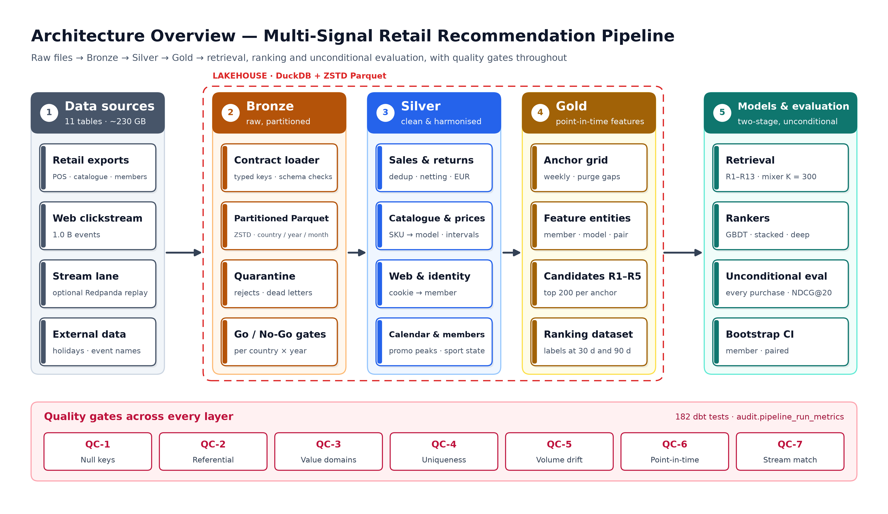
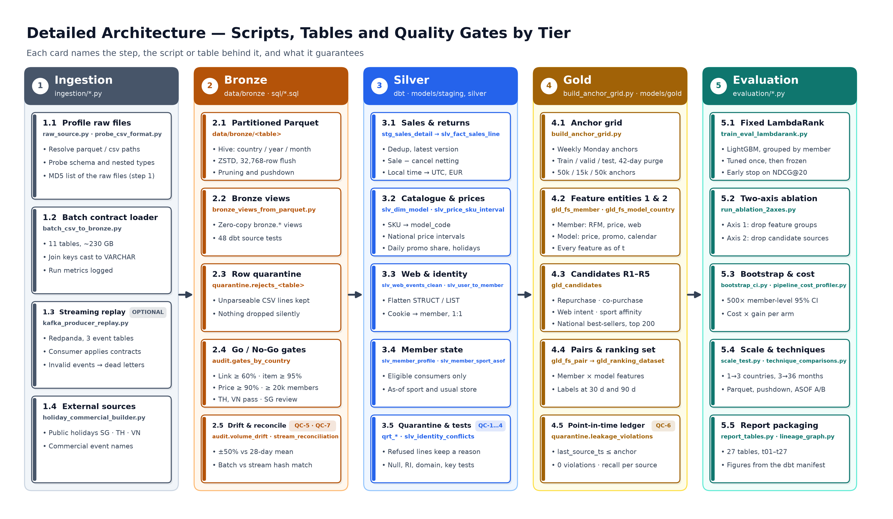
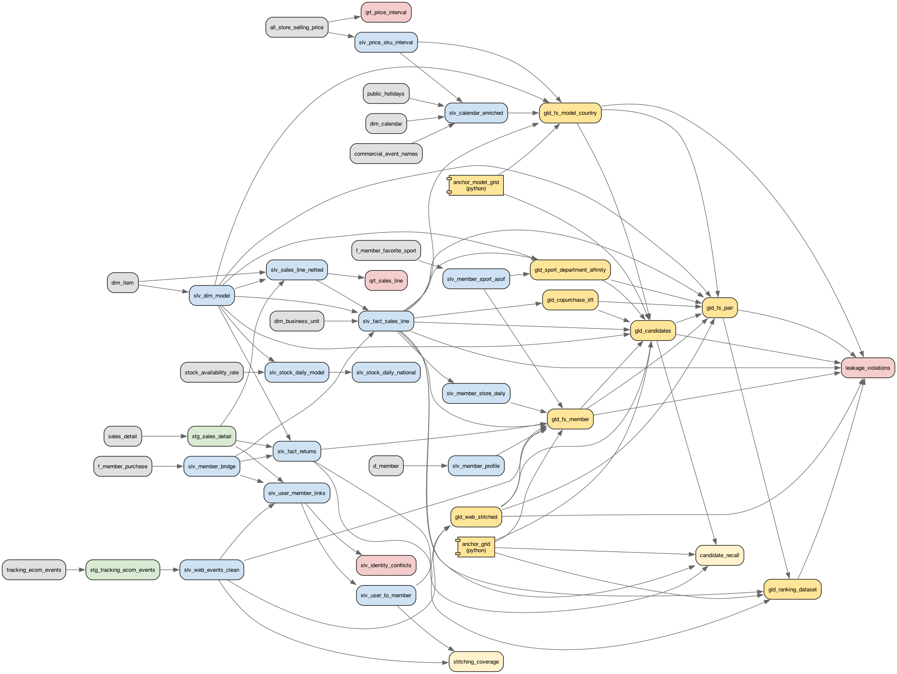
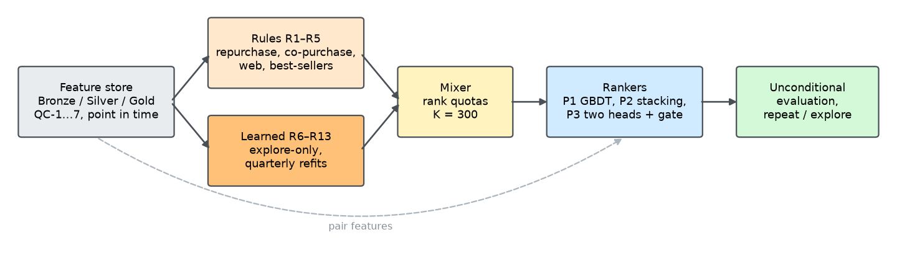

# Multi-Signal Personalized Retail Recommendation: Data Pipeline and Machine Learning

An end-to-end system that turns eleven heterogeneous retail tables — point-of-sale transactions, catalogue, prices, stock, loyalty profiles, favourite sports and web clickstream — into a point-in-time feature store, and on top of it a two-stage personalized recommender (learned retrieval + ranking) evaluated over every purchase, on large-scale, multi-country retail data.

The repository serves two courses of the Master of Information Technology programme, University of Information Technology, Vietnam National University Ho Chi Minh City. The data pipeline was built first for the data-processing course; the machine-learning course extends it with learned retrieval, new rankers and a stricter evaluation protocol, reusing the same lakehouse unchanged.

| | Data Processing Engineering | Advanced Machine Learning and Applications |
|---|---|---|
| Course code | **IT2047.26.1.CH.01** | **IT2043.26.1.CH.01** |
| Report | *Multi-Signal Data Processing and Integration Pipeline for Personalized Retail Recommendation* (October 2026) | *Evaluating and Improving Personalized Product Recommendation with Multi-Signal Machine Learning on Large-Scale Retail Data* (November 2026) |
| Question | What does each data source cost to process, and what does it contribute to ranking accuracy under a fixed model? | Scored on every purchase, where does the recommender fail, and how much do learned retrieval, features, tuning and the model family each add? |
| Main code | `ingestion/`, `sql/`, `dbt_multidim/`, `evaluation/`, `tools/` | `ml/`, `serve/`, `docs/report/hmtt/` |
| Supervisor | Dr. Võ Phương Bình | Dr. Hà Minh Tân |

## Table of Contents

- [Introduction](#introduction)
- [Motivation](#motivation)
- [Architecture](#architecture)
- [Part I — Data Processing Pipeline (IT2047)](#part-i--data-processing-pipeline-it2047)
- [Part II — Advanced Machine Learning (IT2043)](#part-ii--advanced-machine-learning-it2043)
- [Installation Guide](#installation-guide)
  - [Prerequisites](#prerequisites)
  - [Option 1: Installation from GitHub](#option-1-installation-from-github)
  - [Option 2: Streaming lane with Docker](#option-2-streaming-lane-with-docker-optional)
  - [Option 3: Machine-learning extension](#option-3-machine-learning-extension-it2043)
- [Project Structure](#project-structure)
- [Quality Gates](#quality-gates)
- [Results](#results)
  - [Data processing (IT2047)](#data-processing-it2047)
  - [Machine learning (IT2043)](#machine-learning-it2043)
- [Demo](#demo)
- [Troubleshooting](#troubleshooting)
- [Contributing](#contributing)
- [Team](#team)
- [Acknowledgements](#acknowledgements)

## Introduction

Most retail recommender systems in production are driven by a single signal: what a customer bought before. The information that would make recommendations sharper — the price range a customer usually pays, which products sell together, seasonality and promotions, repurchase rhythms, and what the customer browsed online — usually exists inside the company, but it is scattered across many tables, several storage layers, different update frequencies and incompatible identifiers.

This repository builds that missing layer and then the models on top of it. It implements a three-tier **local lakehouse** (Bronze → Silver → Gold) on DuckDB and Parquet, orchestrated with dbt, that ingests about 230 GB of raw CSV and Parquet (about 200 GB of it web and app events) covering three APAC countries (SG, TH, VN) from 2023 to 2026, cleans and reconciles it, and produces three point-in-time feature entities: member, product × country × date, and member–candidate pair (66.1 M net sale lines, 1.0 B web events, 4.7 M buying members, zero leakage violations).

- **Part I (IT2047)** puts a fixed LightGBM LambdaRank model at the end of the pipeline as a measuring instrument, so that every change in recommendation quality can be traced back to a specific data-processing decision and weighed against its processing cost.
- **Part II (IT2043)** re-scores that rule-based recommender over *every* purchase (not only the anchors whose candidate list holds one), shows that most misses are never retrieved, treats retrieval as a model (eight learned candidate sources), and compares a tuned GBDT, a stacked variant and a deep multi-task ranker against five next-basket baselines under one tuning budget.

## Motivation

**Data over model.** Recent work on multi-behaviour and price-aware recommendation (BCIPM, SIGIR 2024; POGCN, KDD 2024; HSTU, ICML 2024; MBRCC, TOIS 2024; and a SIGIR 2026 cross-paradigm reproducibility study) shows that how signals are normalised and integrated matters more than model complexity. Part I makes that engineering work the object of study instead of a preprocessing footnote.

**Real, large and messy data.** Multiple versions of the same transaction, cancelled online orders that net to zero, local timestamps next to UTC ones, five kinds of price labels, nested `Map(k -> v)` strings exported from Spark, and web sessions where only about a third of events carry a member identifier — every classic data-processing problem appears at least once in this dataset.

**Honest evaluation.** The usual offline score is computed only on anchors whose candidate list already holds a purchase. Counted that way the rule-based baseline reaches NDCG@20 0.206; counted over every purchase it scores 0.090 (TH + VN: 0.095), and 40.7 % of the anchors have no purchase in the list at all. Part II starts from that gap.

**Measurable trade-offs.** Part I pairs each ablation arm with the measured processing cost of the data branch it removes (which data source is worth integrating?); Part II separates the gain of features, hyper-parameter tuning and model family on the same candidates (where is the modelling effort worth spending?).

## Architecture



<details>
<summary><b>Detailed End-to-End System & Data-Flow Blueprint & Layer Lineage Diagrams</b> (click to expand)</summary>

### Detailed System & Data-Flow Architecture


### Complete End-to-End Lineage DAG (`Bronze → Silver → Gold`)


### Layer-by-Layer Diagrams
- **Layer 1 — Ingestion, Streaming & Bronze:** [`docs/figures/lineage_ingestion_to_bronze.png`](docs/figures/lineage_ingestion_to_bronze.png)
- **Layer 2 — Bronze → Staging → Silver & Quality Gates:** [`docs/figures/lineage_bronze_to_silver.png`](docs/figures/lineage_bronze_to_silver.png)
- **Layer 3 — Silver → Gold Feature Store & Candidates:** [`docs/figures/lineage_silver_to_gold.png`](docs/figures/lineage_silver_to_gold.png)
- **Layer 4 — Gold → Fixed LightGBM LambdaRank & Two-Axis Ablation:** [`docs/figures/lineage_gold_to_evaluation.png`](docs/figures/lineage_gold_to_evaluation.png)

### Two-Stage Machine-Learning System (IT2043)


See [`docs/figures/README.md`](docs/figures/README.md) for captions and regeneration instructions (`make docs-figures`, `make ml-figures`).
</details>

```
Raw CSV + Parquet (11 tables, ~230 GB)
   │  batch loader (DuckDB)                  optional: Redpanda replay of the 3 event tables
   ▼
BRONZE      ZSTD Parquet, Hive-partitioned (country / year / month)
            data contracts · rejected rows → quarantine · ingestion metadata
   │  dbt-duckdb
   ▼
SILVER      deduplicated sales lines · returns · member bridge · catalogue at model level
            SKU price intervals · holiday & commercial calendar (self-built)
            web events + identity stitching (self-built) · daily stock · favourite-sport state · usual store
   │  dbt-duckdb · quality gates QC-1 … QC-7
   ▼
GOLD        weekly anchor grid · fs_member · fs_model_country · fs_pair
            candidates R1–R5 · labels Δ = 30 / 90 days · leakage assertions
   │                                                   │
   ▼  Python (IT2047)                                  ▼  Python / PyTorch (IT2043)
EVALUATION  fixed LightGBM LambdaRank                 ML    unconditional protocol · error analysis (repeat / explore)
            temporal split with purge gaps                  learned retrieval R6–R13, refitted quarterly · rank-quota mixer (K = 300)
            baseline vs full · two-axis ablation            rankers P1-tuned (GBDT) · P2 (stacked) · P3 (deep multi-task)
            bootstrap CI · cost profiler · scale test       NBR baselines · paired bootstrap · SHAP · cost · static demo
```

Key decisions, frozen in [`docs/DESIGN_DECISIONS.md`](docs/DESIGN_DECISIONS.md) (pipeline) and logged in [`ml/DECISIONS.md`](ml/DECISIONS.md) (ML extension):

| Decision | Value |
|---|---|
| Recommendation unit | `model_code` (product model, not size/colour SKU) |
| Eligible customers | identified members with ≥ 2 transactions; staff, business, legal-entity, club and school accounts excluded |
| Rule candidates per (member, anchor) | 200, from five sources: R1 repurchase, R2 co-purchase, R3 web intent, R4 sport × season/sale, R5 local best-sellers in stock |
| Learned candidates (IT2043) | eight explore-only sources R6–R13 over a per-country top-5 000 universe, refitted at 13 quarterly cutoffs, mixed with R1–R3 / R5 under a cap of K = 300 (`ml.candidates_v2`; R4 dropped) |
| Label windows | Δ = 30 days (primary), 90 days (secondary); a hit is a model bought and not returned |
| Splits | by anchor Monday with a 42-day purge gap: train ≤ 2025-09-15, valid 2025-10-27 … 2025-12-22, test 2026-02-02 … 2026-07-27 |
| Point-in-time rule | every feature uses only data with timestamp ≤ anchor date, enforced by ASOF joins and automated leakage tests; every model-generated table carries its fit cutoff and is checked by QC-6 |
| Evaluation scope | main set TH + VN; SG processed in full but flagged REVIEW |
| Metrics | HR, MRR, NDCG @10 / @20, Recall@50, candidate recall per source, coverage; IT2043 adds the unconditional protocol, recall_repeat / recall_explore @20 and paired member bootstrap |
| Hyper-parameters | IT2047: tuned once on the full configuration, then frozen for every ablation arm. IT2043: every model gets the same budget of 10 Optuna TPE trials on unconditional valid NDCG@20 (checked against 30 trials and three seeds) |

## Part I — Data Processing Pipeline (IT2047)

The data-processing course studies the pipeline itself: under a fixed ranker, what does each data source cost to ingest, clean and integrate, and what does it contribute?

- **Bronze keeps.** A data contract per table ([`ingestion/table_contracts.yml`](ingestion/table_contracts.yml)) declares key, required columns, join-key types and partition. The loader writes ZSTD Parquet partitioned by country / year / month (127 GB, full load in 1 h 51 min, the clickstream alone 87 min); unparseable rows go to quarantine with a reason.
- **Silver corrects, one technique per model.** Versioned deduplication and signed sale − cancel netting; UTC through each unit's time zone (removed a seven-hour shift of online lines); member bridge; SKU → model mapping; national SKU price intervals (difference array + ASOF); a commercial calendar inferred from promotion-share peaks plus public holidays; two-tier cookie → member identity stitching (ORDER / LOGIN) with validity windows. 5.58 M netted lines are refused with one of six reasons and kept in quarantine.
- **Gold respects time.** Anchor grid (Mondays after a member's second purchase), three feature entities, candidates R1–R5, labels Δ = 30 / 90; six singular leakage tests and a QC-6 ledger.
- **Evaluation.** A fixed LightGBM LambdaRank, a B0 baseline (purchase history + national popularity) and ten ablation arms on two axes (feature groups × candidate sources), 500-sample member-level bootstrap CIs, a per-model cost profiler, a scale test (countries × months) and four technique micro-benchmarks.

## Part II — Advanced Machine Learning (IT2043)

The machine-learning course keeps the lakehouse as is and asks four research questions and one hypothesis:

| | Question |
|---|---|
| **RQ1 — data** | Can eleven raw operational exports become a point-in-time, leakage-free feature store at member × week grain on one machine, and what does it hand to the models? |
| **RQ2 — retrieval** | Scored on every purchase, where does the rule-based baseline fail, how much do learned candidate sources raise candidate recall and explore coverage over R1–R5, at what cost, and how much of it reaches NDCG@20? |
| **RQ3 — ranking and tuning** | On the same candidates and budget, which ranker wins (tuned GBDT, stacking, deep multi-task ranker, NBR baselines), and how much of the gain comes from features, tuning and the model family? |
| **RQ4 — value** | How many times better than "best-sellers" and "buy the same again" is the best system, for whom, at what compute cost, and how much of its gain needs data beyond the purchase history? |
| **H1 — hypothesis** | Naive stacking inflates metrics on training and pseudo-test anchors relative to a rolling protocol; on the real test the gap narrows but does not vanish. |

**Unconditional protocol and error analysis** ([`ml/eval/`](ml/eval/)). Every anchor with a purchase counts; positives outside the candidate list are placed below every candidate. Each positive is labelled *repeat* (bought before the anchor) or *explore* [Li et al., TOIS 2023], and each test positive is put in one cell: top 10, rank 11+, proposed but cut by the cap, or proposed by no source.

**Learned retrieval** ([`ml/retrieval/`](ml/retrieval/)). Because R1 already holds 99.7 % of the repeat positives, every learned source is explore-only (it masks models the member bought before), is fitted per country at each quarterly cutoff over the top 5 000 models by buyers in the previous 365 days, proposes 100 candidates per anchor, and is tuned on the explore coverage it *adds* to R1–R5:

| Source | Model | Δ explore coverage (valid) |
|---|---|---|
| R6 | EASE, closed-form item–item auto-encoder | +0.085 |
| R7 | item2vec over baskets | +0.074 |
| R8 | TIFU-KNN | +0.057 |
| R9 | two-tower, softmax over explore targets | +0.074 |
| R10 | SASRec, dense all-action explore loss (PinnerFormer-style) | +0.085 |
| R11 | explin, windowed linear model with closed-form ridge | +0.074 |
| R12 | RP3beta random walk | +0.088 |
| R13 | context-aware trend | +0.069 |

A rank-quota **mixer** merges them (key = min over sources of (rank − 0.5) / w, w = stand-alone valid Recall@100) and keeps the K = 300 smallest keys; K is chosen from the recall–cost curve.

**Rankers** ([`ml/rankers/`](ml/rankers/), [`ml/signals/`](ml/signals/), [`ml/umtr/`](ml/umtr/), [`ml/baselines/`](ml/baselines/)), all on the same `candidates_v2` lists and selected on unconditional valid NDCG@20:

- **P1-frozen** — the Part I LambdaRank with its frozen hyper-parameters and 73 Gold pair features, refitted on the v2 pairs (reference row).
- **P1-tuned** — LightGBM LambdaRank over all 85 pair columns (the 73 plus 12 new ones, among them the ranks of the eight learned sources).
- **P2** — P1-tuned plus five stacked signal columns from a department-purchase hazard model and two willingness-to-pay quantile models, fitted with the rolling protocol.
- **P3 (UMTR)** — a Transformer over the last 50 purchase lines, a member-context MLP, an item tower over the pair features and DIN-style target attention (3.7 M parameters), with repeat and explore listwise heads mixed by a learned member-level gate; ablations: one head, fixed gate, no sequence, no target attention.
- **NBR baselines** — P-TopFreq, GP-TopFreq, EASE, TIFU-KNN and SASRec as full-catalogue rankers with their own tuning budget.

**H1 leakage study** — the same department hazard fitted three ways (rolling, naive in-sample, leaky on every split) and fused into a ranker, measured on its training anchors, a pseudo-test quarter and the real test.

The paper is [`docs/report/hmtt/main.tex`](docs/report/hmtt/main.tex) (IEEE Access template, built to [`main.pdf`](docs/report/hmtt/main.pdf) by `make report-pdf`); every number comes from a table in [`docs/report/tables/ml/`](docs/report/tables/ml/).

## Installation Guide

The pipeline runs on a laptop for development (one country, without the full web-event table) and on a 16-thread / 125 GB RAM / 894 GB NVMe server for the full three-country run. All SQL is DuckDB-flavoured and platform independent. The machine-learning extension ran on one shared GH200 node (72 Arm cores, one Hopper-class GPU, bfloat16 mixed precision for the deep models); the GBDT rankers and the classical sources also run on CPU.

| | Raw size | Format |
|---|---|---|
| `tracking_ecom_events` | ≈ 200 GB | 1,774 daily Parquet parts, ≈ 1.0 B events |
| `sales_detail` | 12.2 GB | Parquet |
| `stock_availability_rate` | 5.4 GB | CSV |
| `d_member` | 2.0 GB | CSV |
| `dim_item` | 0.7 GB | Parquet |
| `f_member_purchase`, `sales_tender_detail`, `all_store_selling_price` | 3.8 GB together | Parquet |
| `f_member_favorite_sport`, `dim_business_unit`, `dim_calendar` | < 0.1 GB together | CSV |
| **Total** | **≈ 230 GB** (≈ 27 GB without web events) | |

### Prerequisites

- Python 3.11
- DuckDB ≥ 1.1, dbt-core ≥ 1.8, dbt-duckdb ≥ 1.8 (the reported runs used DuckDB 2.0 and dbt 1.12)
- pyarrow, pandas, polars, pyyaml, python-dotenv
- holidays, lightgbm, scikit-learn, psutil, matplotlib (on macOS LightGBM needs the OpenMP runtime: `brew install libomp`)
- confluent-kafka and Docker (optional, streaming lane only)
- For Part II: PyTorch (CUDA build matching the driver), optuna, gensim, shap and the rest of [`ml/requirements.txt`](ml/requirements.txt); pdfLaTeX (e.g. TinyTeX) to rebuild the paper
- DBeaver (optional, to browse the lakehouse read-only)
- Disk: ≥ 150 GB free for a one-country development run; for the full run, NVMe with room for the ≈ 230 GB raw set plus Bronze, Silver, Gold and DuckDB spill (the server above has 894 GB)

Pipeline dependencies are listed in `requirements.txt`, ML dependencies on top of them in `ml/requirements.txt`.

### Option 1: Installation from GitHub

1. **Clone the repository**

   ```bash
   git clone https://github.com/haiiyins/retail_multidim_pipeline.git
   cd retail_multidim_pipeline
   ```

2. **Create a virtual environment**

   ```bash
   python3.11 -m venv .venv
   # or, if the python3.11 binary is not installed:
   uv venv --python 3.11 .venv
   ```

3. **Activate the virtual environment**

   ```bash
   source .venv/bin/activate        # Windows: .venv\Scripts\activate
   ```

4. **Install dependencies**

   ```bash
   pip install -r requirements.txt
   ```

5. **Configure the environment**

   ```bash
   cp .env.example .env
   ```

   Edit `.env`: `DATA_ROOT`, `DUCKDB_PATH`, `DUCKDB_MEMORY` (about 60–70 % of RAM), `DUCKDB_THREADS` (parallelism of each query), `DBT_THREADS` (models built concurrently: 4 on the laptop, 1 on the server, see RUNBOOK Appendix B), `COUNTRY_FILTER` (a single country code while developing, `ALL` for the full run) and `COUNTRIES` (`SG,TH,VN`, the evaluation scope).

   Use **absolute paths** for `DATA_ROOT` and `DUCKDB_PATH`. dbt runs from `dbt_multidim/` while the Python scripts run from the repository root, so a relative path points to two different files. `make` normalises relative paths; a plain `dbt` command does not.

   Check the setup with `cd dbt_multidim && dbt deps && dbt debug` (export the variables first: `set -a; source .env; set +a`). All checks must pass before continuing.

6. **Place the raw data**

   Put the eleven raw tables in `data/raw_csv/` as `<table>.parquet` (single file), `<table>/*.parquet` (directory of parts) or `<table>.csv`; when several exist for one table the precedence is that order. The 2026-10-27 re-export delivers `sales_detail`, `sales_tender_detail`, `f_member_purchase` and `all_store_selling_price` as single Parquet files and `tracking_ecom_events` as a directory of about 1,800 daily Parquet parts (sub-folder of the Drive folder); the other six tables stay CSV. The download and renaming commands are in [`docs/RUNBOOK.md`](docs/RUNBOOK.md) §1.2. The `data/` directory is git-ignored.

7. **Run the pipeline**

   ```bash
   make probe      # step 2 — profile the raw files (+ make probe-full) → data/audit/csv_profile.md
   make bronze     # step 3 — raw CSV/Parquet → partitioned Parquet, scope = COUNTRY_FILTER → bronze.* views
   make gates      # step 4 — four go/no-go gates + audit checks
   make silver     # step 5 — holiday calendar, dbt run / test for Silver
   make gold       # step 6 — anchor grid, feature store, candidates, leakage tests
   make train      # step 7 — full ranker, freezes hyper-parameters
   make ablation   # step 7 — baseline + 10 ablation arms × Δ
   make docs       # dbt lineage documentation
   ```

   `make all` runs steps 3 to 7 in sequence. `make techniques` runs the four micro-benchmarks and `make report-tables` regenerates `docs/report/tables/`.

8. **Inspect the lakehouse**

   Open `data/lakehouse.duckdb` in DBeaver with the driver property `access_mode = READ_ONLY` (or `duckdb.read_only = true`). Disconnect DBeaver before running `make` or `dbt`: a DuckDB writer needs an exclusive lock on the file, and any other open connection, even read-only, blocks it.

### Option 2: Streaming lane with Docker (optional)

The three event tables (web tracking, favourite sports, member–purchase links) can additionally be replayed through a Kafka-compatible broker to demonstrate hybrid batch/stream ingestion with contract checks and a dead-letter queue. Batch Bronze remains the source of truth; the stream output is reconciled against it (gate QC-7).

1. **Start Redpanda and its console**

   ```bash
   docker compose up -d             # console at http://localhost:8080
   ```

2. **Replay one country-month and consume it**

   ```bash
   REPLAY_COUNTRY=XX REPLAY_MONTH=2025-01 python ingestion/kafka_producer_replay.py
   python ingestion/kafka_consumer_to_bronze.py
   ```

   The producer writes one topic per event table (`raw.tracking`, `raw.favorite_sport`, `raw.member_purchase`), each ordered by its event time, and prints the message count and msg/s per topic. `REPLAY_TOPICS=raw.tracking` restricts it to one topic.

3. **Reconcile** the stream output with the batch Bronze tables with `python ingestion/qc7_stream_reconciliation.py` (see `docs/RUNBOOK.md` §8), which writes `audit.stream_reconciliation`. The per-day difference must be zero.

### Option 3: Machine-learning extension (IT2043)

Requires a built Gold layer (Option 1, steps 1–7). ML jobs attach the lakehouse read-only, write Parquet under `data/ml/` and expose it as `ml.*` views.

1. **Install the ML dependencies**

   ```bash
   uv pip install torch --index-url https://download.pytorch.org/whl/cu130   # pick the index matching your CUDA driver
   pip install -r ml/requirements.txt
   make ml-test                                                              # unit tests incl. point-in-time checks
   ```

2. **Re-evaluate the baseline and locate its errors**

   ```bash
   make ml-seq                                    # purchase / web sequences at each anchor
   make ml-eval                                   # P1-frozen under the unconditional protocol → t28
   python ml/eval/error_analysis.py --out t28b    # repeat / explore × top 10 / rank 11+ / capped / no source
   ```

3. **Learned retrieval and the mixer**

   ```bash
   make ml-retrieval                              # tune + build R6–R13 at every quarterly cutoff
   python ml/retrieval/mixer.py                   # rank-quota mixer (fixed and per-member policies)
   python ml/retrieval/build_candidates.py        # ml.candidates_v2 (K = 300), QC-6 and cap checks
   python ml/common/pairs.py                      # Gold pair SQL rendered on candidates_v2 → pairs_v2
   python ml/retrieval/recall_curve.py --out t30  # coverage against K
   ```

4. **Rankers and baselines**

   ```bash
   python ml/rankers/frozen.py --source v2 --name p1_frozen_v2
   python ml/rankers/gbdt.py --tune p1 --source v2 --final --name p1_tuned_v2
   python ml/signals/run_rolling.py && python ml/signals/run_leakage_study.py --source v2    # P2 signals, H1 study
   python ml/rankers/gbdt.py --tune p2 --source v2 --signals --final --name p2_v2
   python ml/umtr/train.py --source v2 --tune
   python ml/umtr/train.py --source v2 --final --variants full,onehead,fixedgate,noseq
   python ml/baselines/topfreq.py
   python ml/baselines/nbr.py --source ease --tune --build      # likewise tifuknn; sasrec / sasrec_all with --build
   ```

5. **Compare, explain and write up**

   ```bash
   python ml/eval/compare.py --out t31 --models ptopfreq,gptopfreq,ease_nbr,tifuknn_nbr,p1_frozen_v2,p1_tuned_v2,p2_v2,p3_full,p3_onehead
   python ml/eval/paired.py --pairs p3_onehead:p3_full,p3_noseq:p3_full --out t32_paired
   python ml/analysis/explain.py && python ml/analysis/business.py --best p3_onehead && python ml/analysis/cost.py
   make ml-figures && make report-pdf
   ```

   Seed variance, the 30-trial budget, K = 500 (`candidates_v3`) and the purchase-history-only ranker are flags of the same scripts (`--seed`, `--budget 30`, `--k 500 --version v3`, `--history-only`); see each script's docstring and [`ml/DECISIONS.md`](ml/DECISIONS.md).

## Project Structure

```
retail_multidim_pipeline/
├── ingestion/              CSV probe, batch CSV → Bronze, data contracts, holiday calendar, Kafka replay / consumer / QC-7 reconciliation
├── sql/                    go/no-go gates and audit checks
├── dbt_multidim/           dbt-duckdb project
│   ├── macros/             Map(k -> v) extraction, promotion kinds, country filter
│   ├── models/staging/     type harmonisation views, sources and tests
│   ├── models/silver/      cleaned and integrated tables
│   ├── models/gold/        feature store, candidates, ranking dataset
│   └── tests/              leakage and integrity assertions
├── evaluation/             [IT2047] anchor grid, LightGBM ranker, ablation matrix, bootstrap CI, cost profiler, scale test, technique comparisons
├── ml/                     [IT2043] machine-learning extension
│   ├── common/             lakehouse access, point-in-time cutoffs, sequences, pair rendering, tuning harness
│   ├── retrieval/          R6–R13 (EASE, item2vec, TIFU-KNN, two-tower, SASRec, explin, RP3beta, trend), mixer, candidates_v2
│   ├── rankers/            P1-frozen, P1-tuned / P2 (LightGBM LambdaRank)
│   ├── signals/            P2 hazard and willingness-to-pay signals, H1 leakage study
│   ├── umtr/               P3 deep multi-task ranker (PyTorch)
│   ├── baselines/          P-TopFreq, GP-TopFreq, EASE / TIFU-KNN / SASRec as NBR rankers
│   ├── eval/               unconditional protocol, error analysis, comparison tables, paired bootstrap
│   ├── analysis/           SHAP, business value, cost, figures and report tables
│   ├── config/             retrieval / sequences / tuning / umtr settings
│   ├── tests/              unit tests (point-in-time, protocol, retrieval, UMTR)
│   └── DECISIONS.md        decisions taken during the ML run, with evidence
├── serve/                  [IT2043] static Hugging Face Space demo (Pyodide), anonymised reference export, publication checks
├── tools/                  lineage graphs, EXPLAIN figures, report tables
├── docs/                   RUNBOOK.md · DESIGN_DECISIONS.md · figures/ (+ figures/ml/)
│   └── report/             IT2047 chapter drafts and tables/ · hmtt/ IT2043 paper (main.tex, main.pdf, slides.md) · tables/ml/
├── data/                   git-ignored: raw_csv, bronze, silver, gold, quarantine, audit, ml, duck_temp
├── .github/                PR template, Space deployment workflow
├── Makefile
├── .env.example
├── requirements.txt
└── docker-compose.yml
```

## Quality Gates

| Gate | Check | On failure |
|---|---|---|
| QC-1 | Null keys = 0 | block |
| QC-2 | Referential integrity ≥ 95 / 60 / 90 % per country | block (main set) / warn |
| QC-3 | Value domains: `promo_depth ∈ [0, 0.9]`, `price > 0`, `qty > 0` | route rows to quarantine |
| QC-4 | Uniqueness after deduplication and netting | block |
| QC-5 | Volume drift ± 50 % vs the 28-day trailing mean of the same weekday (`audit.volume_drift`; raw rows vs distinct line keys expose duplicated exports) | warn |
| QC-6 | Point-in-time: `max(source_ts) ≤ anchor_date`, `identity_verified_ts ≤ anchor_date`; for ML tables also `fit_cutoff ≤ anchor_date` | block, log |
| QC-7 | Batch vs stream reconciliation | report |

The dbt project holds 31 models with 182 tests; the 64 Gold tests pass and the QC-6 ledger (`quarantine.leakage_violations`) holds zero rows in all three countries.

## Results

### Data processing (IT2047)

**Go / no-go gates (three-country run, 2026-10-28).** `audit.gates_by_country` applies four thresholds per country × year — member-link rate ≥ 60 %, item match ≥ 95 %, price coverage ≥ 90 %, ≥ 20,000 members with two transactions or more ([`docs/report/tables/t04_gates.md`](docs/report/tables/t04_gates.md)). TH and VN pass every year. SG passes 2025 only and misses the member-link gate in 2023, 2024 and 2026 (50.3 / 57.9 / 59.3 %). **Main evaluation set: TH + VN. SG is a REVIEW country**: processed end to end but excluded from the headline confidence intervals, because its labels miss the repurchases of unlinked transactions.

**After processing.** 66.1 M net sale lines kept of 89.3 M raw lines (26.3 M transactions, 4.7 M buying members); 9.5 % duplicate sales rows from overlapping extracts removed; a seven-hour shift of online lines found by the point-in-time tests and fixed before training; identity stitching raises the share of web events linked to a member by 6–8 points (SG 36 → 42 %, TH 34 → 40 %, VN 30 → 38 %).

**Full pipeline (test, all countries, Δ = 30).** NDCG@20 **0.2068** [0.2040, 0.2097], HR@10 0.367, Recall@50 0.559 over 36,407 members ([`t23`](docs/report/tables/t23_full_by_scope.md)).

**Ablation × cost** (paired difference to Full, 500-sample member bootstrap; [`t22`](docs/report/tables/t22_ablation_results.md), [`t24`](docs/report/tables/t24_cost_gain.md)):

| Removed | Δ NDCG@20 (Δ = 30) | Δ = 90 | Processing cost of the source |
|---|---|---|---|
| R1 repurchase | −0.1113 | −0.1091 | none beyond fact / product entities |
| R5 best-sellers | −0.1061 | −0.1052 | none beyond `gld_fs_model_country` |
| R2 co-purchase | −0.0193 | −0.0153 | 20 s model wall time |
| Web features / R3 web candidates | −0.0161 / −0.0159 | −0.0076 / −0.0081 | 5,221 s Bronze load + 1,254 s models, 82.1 GB peak RSS, 89.3 GB output |
| Price | −0.0029 | −0.0027 | 36 s |
| Sport features / R4 sport × offer | −0.0013 / −0.0012 | n.s. | 4 s |
| Promotion & calendar | −0.0005 (n.s.) | −0.0008 | 4 s |
| B0 (history + popularity only) | −0.0179 | −0.0128 | six models |

Repurchase and national best-sellers are the backbone (> 50 % of NDCG@20 each); co-purchase is the most cost-effective second-order signal; the clickstream uses 91 % of Bronze storage and 97 % of source-attributable transformation time for +0.016 NDCG@20 at 30 days, halving at 90 days.

**Micro-benchmarks (VN, server).** Parquet vs CSV 6.9×, column projection 8.8×, ASOF join vs daily explode 1.6× (2.86 → 1.74 GB), SQL regex vs row-wise Python 15.2×. **Scale test:** VN → VN + TH + SG takes Silver → Gold from 379 s to 3,866 s (Gold super-linear at the 80 GB memory ceiling); 3 → 36 months of VN history costs only ×1.3 the time.

### Machine learning (IT2043)

All numbers on the test split (2026-02 … 2026-07), TH + VN, Δ = 30, unconditional protocol, 41,734 anchors, unless noted.

**RQ2 — where the baseline fails.** Scored conditionally P1-frozen reaches NDCG@20 0.206; unconditionally 0.095. Of 213,289 test positives, 91 % are explore; 58 % were proposed by no source, almost all explore (74.5 % of explore positives never reach the ranker), while repeats are largely solved (65 % in the top 10).

**RQ2 — learned retrieval.** Candidate coverage rises from **0.370 (R1–R5, 200) to 0.450 (mixer, K = 300)**, explore coverage 0.307 → 0.400 (× 1.30). RP3beta is the best single source and trains in minutes; the two neural sources (two-tower, SASRec) cost 50–100× more compute for the same or lower gain. With the ranker frozen, the retrieval gain reaches NDCG@20 only partly (+0.0025).

**RQ3 — ranking** ([`t31`](docs/report/tables/ml/t31.md), 95 % member-bootstrap CI):

| Model | NDCG@20 | 95 % CI | HR@10 | recall_repeat@20 | recall_explore@20 |
|---|---|---|---|---|---|
| P-TopFreq | 0.0615 | [0.0597, 0.0632] | 0.156 | 0.877 | 0.000 |
| GP-TopFreq | 0.0752 | [0.0734, 0.0769] | 0.184 | 0.878 | 0.041 |
| TIFU-KNN NBR (best baseline) | 0.0788 | [0.0770, 0.0806] | 0.187 | 0.885 | 0.043 |
| P1-frozen (R1–R5 candidates) | 0.0947 | [0.0925, 0.0968] | 0.225 | 0.824 | 0.073 |
| P1-tuned (v2) | 0.1011 | [0.0990, 0.1033] | 0.239 | 0.817 | 0.092 |
| P2 (v2, stacked) | 0.1013 | [0.0994, 0.1034] | 0.240 | 0.806 | 0.093 |
| P3 two heads | 0.1009 | [0.0988, 0.1029] | 0.237 | 0.845 | 0.089 |
| **P3 one head** | **0.1020** | [0.0999, 0.1040] | 0.240 | 0.838 | 0.090 |

- Every two-stage ranker beats every NBR baseline by more than a quarter (P1-tuned − TIFU-KNN: +0.022).
- **Features > tuning > model family:** of P1-tuned's +0.0039 over P1-frozen, the new features give +0.0028 and tuning +0.0011; P3 one head adds +0.0009 (≈ 1 %) over P1-tuned, stable over three seeds (spread ≤ 0.0003). Stacking (P2) adds nothing measurable.
- In P3 the learned gate carries the benefit (fixed gate: −0.0066), not the explicit repeat / explore split (one head is better).
- Neither a 30-trial budget nor K = 500 improves valid NDCG@20; the 10-trial, K = 300 fits are kept.

**H1 — stacking leakage.** Naive in-sample signals look better than rolling ones on their training anchors (+0.0026) and the pseudo-test (+0.0029) and fall behind on test (−0.0004); the inflation is small because the signals add little over the Gold features.

**RQ4 — value.** P3 one head reaches HR@10 0.240: **1.8× the best-sellers and 1.5× "buy the same again"**, matching buy-again on repeats in the same list of ten. On purchase history alone the pipeline reaches 0.0966 vs 0.0752 for GP-TopFreq — about four fifths of the gain — and the web, price, promotion, stock and store dimensions add the rest, mostly on explore purchases. Offline GMV proxy: 268 EUR of observed next-30-day purchase value per 1,000 recommendations vs 184 for buy-again and 79 for best-sellers (not a causal estimate).

## Demo

A static page on a public Hugging Face Space, [`yphan3103/nbr-demo`](https://huggingface.co/spaces/yphan3103/nbr-demo), runs the retrieval layer in the browser (Pyodide): upload a purchase file and get each member's top K with the source and a reason for every item (repeat with time decay, EASE co-purchase neighbours, recent country trend, merged with the mixer's rank-quota rule). A second tab shows the batch output of the best model (P3 one head vs GP-TopFreq) for 500 anonymised real test members. Model identifiers are salted hashes, departments carry generic labels, sample members are synthetic, and every deployment is gated by `serve/check_public.py`. Details in [`serve/ABOUT.md`](serve/ABOUT.md).

## Troubleshooting

| Symptom | Cause | Fix |
|---|---|---|
| `Could not set lock on file … Conflicting lock is held` on `dbt run` or a loader | another process has the database open, usually DBeaver, even read-only | disconnect DBeaver (right-click the connection → Disconnect), rerun, reconnect afterwards |
| Out of memory on a large join | `memory_limit` too high, or the spill directory full (dbt spills to `data/lakehouse.duckdb.tmp`, the loaders to `data/duck_temp`) | lower `DUCKDB_MEMORY`; make sure `data/duck_temp` exists and has space |
| Regex extraction returns mostly null | key name or spacing differs in the raw string | inspect five raw `metadata` values and adjust the pattern in `dbt_multidim/macros/extract_map_field.sql` |
| `ASOF JOIN` error | only one inequality on the time column is allowed | write `ON a.key = b.key AND a.ts >= b.ts` |
| `Cannot open file ".../dbt_multidim/data/lakehouse.duckdb"` on `dbt debug` | relative `DUCKDB_PATH` / `DATA_ROOT` resolved from `dbt_multidim/` | use absolute paths in `.env`, or run dbt through `make` (which normalises them) |
| `python3.11: command not found` | Python 3.11 not installed | `uv venv --python 3.11 .venv` (uv downloads the interpreter) |
| `accepted_values` test fails | a value not seen during profiling | check `csv_profile.md`, extend the list, note it in the report |
| LightGBM slow or out of memory | pair table too large | raise `TRAIN_ANCHOR_STRIDE`, lower `N_CANDIDATES`, or move to the server |
| `Library not loaded: @rpath/libomp.dylib` on `import lightgbm` (macOS) | OpenMP runtime missing | `brew install libomp` |
| ranker smoke test on the laptop | 23 M pair rows do not fit in pandas | rebuild Gold with small caps, e.g. `TRAIN_ANCHOR_CAP=5000 VALID_ANCHOR_CAP=2000 TEST_ANCHOR_CAP=5000 make gold`, then `python evaluation/train_eval_lambdarank.py --config full --delta 30 --no-freeze --tag smoke` |
| ML job blocked while dbt runs | the `ml/` jobs attach the lakehouse read-only but `publish_view()` briefly needs the write lock | run ML jobs after `make gold` finishes; several ML jobs can read at once |
| `Exception ignored in our_dot_float` from gensim (aarch64) | rare multi-worker dot-product warning in item2vec | harmless, the vectors are finite; it is filtered from the logs |
| P3 / neural sources very slow | no GPU visible to PyTorch | install the CUDA build of torch matching the driver; the GBDT rankers and classical sources run on CPU |

More cases are covered in `docs/RUNBOOK.md`, Appendix B. For anything else, open an issue in this repository.

## Contributing

This is a course project maintained by the team below; contributions from team members follow the work-breakdown structure in `docs/DESIGN_DECISIONS.md` (pipeline) and the ML plan logged in `ml/DECISIONS.md`.

1. Create a branch per work package: `feat/<wbs>-<short-name>` (for example `feat/2.3-price-intervals`, `feat/ml-26b-history-only`).
2. Every new dbt model ships with `schema.yml` tests; Gold models must pass the leakage assertions in `dbt_multidim/tests/`. Every new `ml/` table carries its fit cutoff and passes `ml/common/pit.py`; run `make ml-test` before opening a pull request.
3. Keep code, comments, commit messages and documentation in English. Never commit anything under `data/`, `.env` or `*.duckdb`.
4. Open a pull request against `main` using the template; one reviewer approves before merging. `main` is not protected technically (branch protection is unavailable on GitHub Free for private repositories), so this is a team rule: never push or force-push to `main` directly.
5. Demo Space: a merge to `main` that touches `serve/` redeploys the public Hugging Face Space (`.github/workflows/deploy-space.yml`, about two minutes; no Hugging Face account needed). The workflow keeps the anonymised reference already on the Space and replaces the page and code (`index.html`, `recommend.py`, `ABOUT.md`). Preview locally with `python serve/build_space.py --ref-csv <reference folder downloaded from the Space>` and `python -m http.server` in `data/demo/space`. A new reference (new as-of date, new back-test sample) is published from the server only: `make demo-reference && make demo-push`.

Suggestions and bug reports from outside the team are welcome through the issue tracker.

## Team

| Member | Responsibilities (IT2047 Data Processing Engineering) |
|---|---|
| **Phan Nguyễn Hải Yến** | Repository governance and environment validation; dbt sources and source tests; value-domain and nested-column checks; Silver: SKU price intervals, public holidays and inferred commercial calendar, clean web events, two-tier identity stitching; Gold: stitched web events and the model × country feature entity; feature-axis ablation, bootstrap confidence intervals and segment analysis; report chapters on data, processing and quality, final slides and demo script, submission checklist |
| **Nguyễn Viết Kha** | Raw-file download and checksums, profiling of the 11 tables, server provisioning and DuckDB tuning, batch loading into Bronze; go / no-go gates and PASS / REVIEW grouping; QC-1 / QC-3 / QC-4 tests and quarantine routing, QC-5 volume drift, QC-6 leakage assertions; streaming lane (Redpanda replay, consumer with dead-letter queue, QC-7 reconciliation); candidate-axis ablation, cost profiler and cost × gain table, scale test, technique comparisons; lineage figures and DBeaver evidence |
| **Lê Đức Mạnh** | Inter-purchase and date-span audits and the temporal split; Silver core tables: member bridge and profile, model catalogue, deduplicated and netted sales fact, returns, daily stock, favourite-sport and usual-store state; Gold: anchor grid with training stride, co-purchase lift, member feature entity, five-source candidate generation, pair features and ranking dataset with labels; ranker training with frozen hyper-parameters and the B0 baseline; report chapter on experiments and results |

<!-- TODO: add the per-member responsibilities for IT2043 Advanced Machine Learning and Applications. -->
The IT2043 paper is co-authored by the same three members (Yen Phan, Manh Le, Kha Nguyen; equal contribution).

Supervisors, University of Information Technology, VNU-HCM:
- IT2047 Data Processing Engineering — **Dr. Võ Phương Bình**, Faculty of Information Science and Engineering.
- IT2043 Advanced Machine Learning and Applications — **Dr. Hà Minh Tân**.

## Acknowledgements

The team thanks Dr. Võ Phương Bình and Dr. Hà Minh Tân for supervising the two course projects. The approach draws on published work on multi-behaviour and price-aware recommendation (SIGIR, KDD, ICML, TOIS, 2024–2026), next-basket recommendation (Li et al., TOIS 2023; TIFU-KNN, SIGIR 2020), item-based and neural retrieval (EASE, RP3beta, item2vec, two-tower, SASRec, PinnerFormer), DIN and multi-task ranking, and on the open-source projects DuckDB, Apache Parquet, dbt, Redpanda, LightGBM, PyTorch, Optuna, gensim, SHAP and the Python `holidays` library. The dataset was made available for academic use; no organisation-specific identifiers or personal paths are included in this repository.
