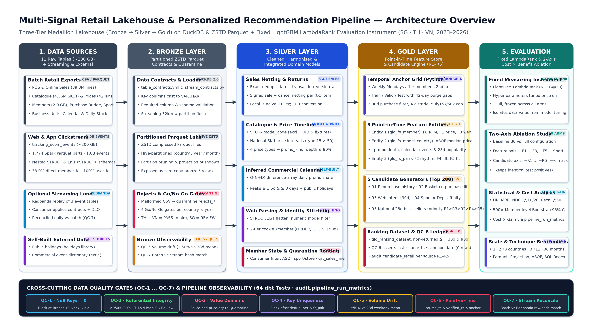
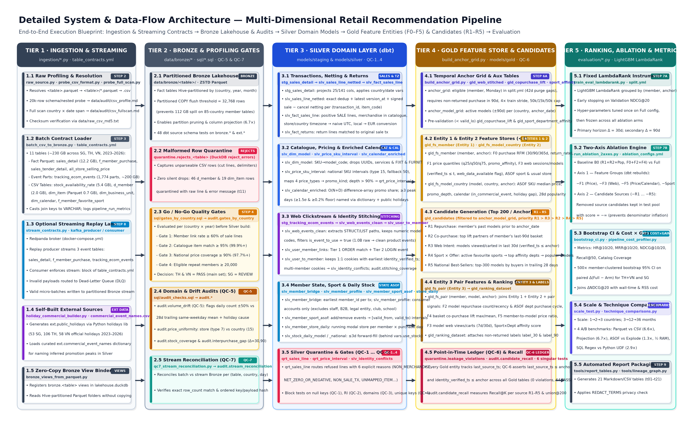
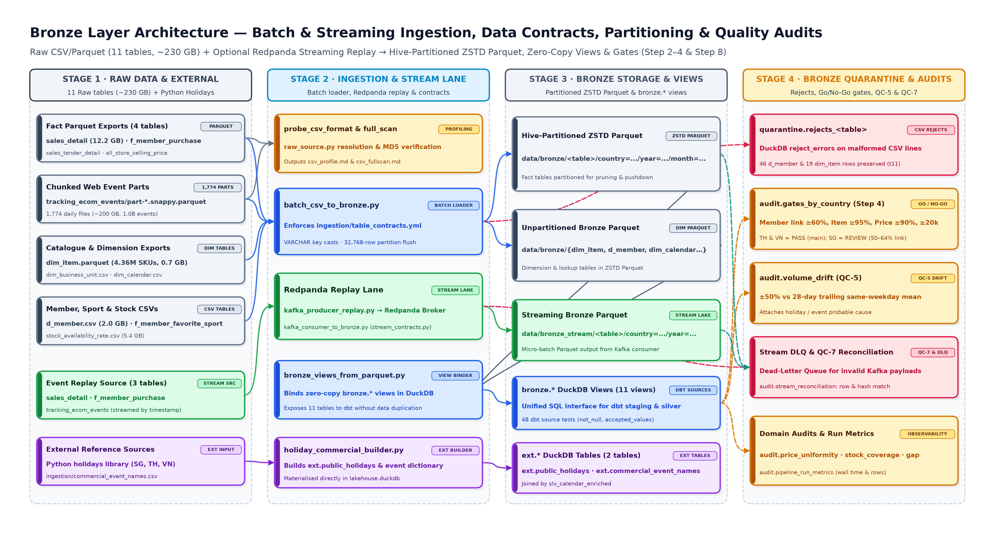
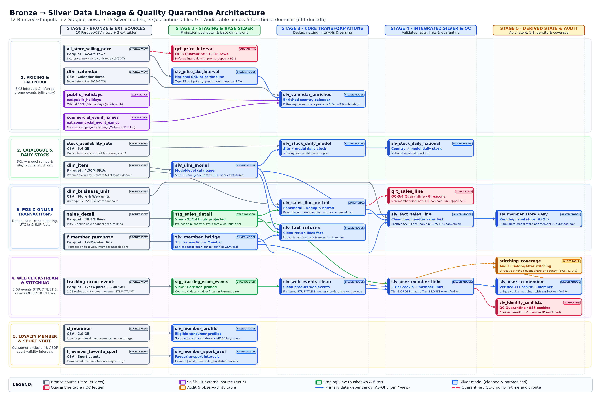
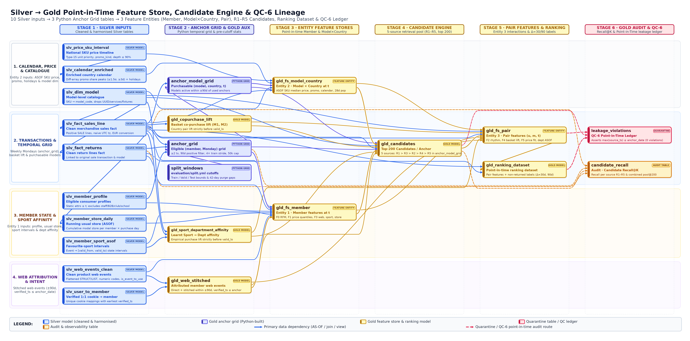
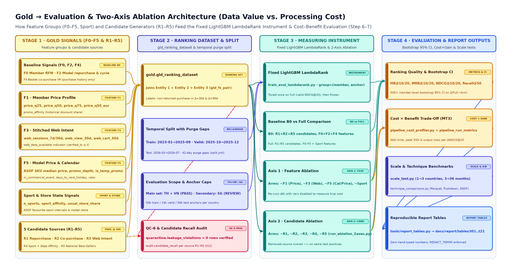
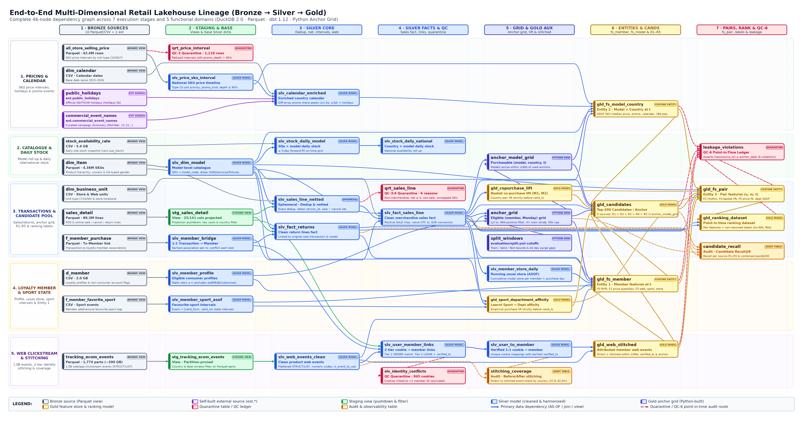

# Figures for the report and the demo (WBS 5.1, issue #44)

Generated files (reproducible). `tools/lineage_graph.py` renders seven publication-grade vector (`.svg`) and raster (`.png`, 260–300 DPI)
diagrams using `matplotlib` directly from `dbt_multidim/target/manifest.json` (with SQL comment stripping so documentation comments never
introduce false edges). The figure suite covers two end-to-end synthesis views (generalized and detailed) and five layer-specific / DAG
lineage views organised into semantic domain swimlanes and dependency stages:

### 1. End-to-End Synthesis Diagrams (Generalized & Detailed)

| file | level | caption | how to regenerate |
|---|---|---|---|
| `architecture_overview.svg` / `.png` | Generalized (High-Level) | End-to-end generalized medallion lakehouse architecture: 6 macro stages from Raw Multi-Country Sources (~230 GB, 11 tables) → Bronze Lakehouse → Silver Cleansed & Reconciled → Gold Point-in-Time Feature Store (3 Entities, R1–R5, F0–F5) → Fixed LightGBM LambdaRank & Two-Axis Ablation, plus the cross-cutting Quality Gate & Observability Spine (QC-1 … QC-7) | `make docs-figures` |
| `architecture_detailed.svg` / `.png` | Detailed (System & Data-Flow) | End-to-end detailed system and data-flow blueprint across Steps 1–7: Raw CSV/Parquet + optional Redpanda streaming lane, Bronze ZSTD Hive-partitioned Parquet & views, Silver domain swimlanes (POS netting, reference & price intervals, enriched calendar, web stitching), Gold anchor grid (`evaluation/build_anchor_grid.py`), 3 Feature Store entities (`gld_fs_member`, `gld_fs_model_country`, `gld_fs_pair`), 5 candidate sources (`R1`–`R5`), 6 feature groups (`F0`–`F5`), QC-6 leakage assertions, and evaluation outputs | `make docs-figures` |

### 2. Layer-by-Layer & dbt Lineage Diagrams

| file | scope | caption | how to regenerate |
|---|---|---|---|
| `lineage_full.svg` / `.png` | Full DAG (46 nodes, 90 edges) | Complete end-to-end lineage across 7 stages and 5 domain swimlanes: Bronze sources → Staging views → Silver core → Silver derived / Quarantine / Audit → Gold Feature Store & Candidates → Ranking Dataset & QC-6 Leakage Ledger | `make docs-figures` |
| `lineage_ingestion_to_bronze.svg` / `.png` | Raw → Ingestion → Bronze | Detailed ingestion and Bronze layer architecture: 11 raw sources, batch loader (`batch_csv_to_bronze.py`) with `table_contracts.yml` & streaming threshold (`32,768` rows), optional Redpanda replay + consumer (`kafka_consumer_to_bronze.py`), Hive-partitioned ZSTD Parquet + `bronze.*` views, `quarantine.rejects_*`, `quarantine.rejected_stream_events`, and QC-7 reconciliation (`audit.stream_reconciliation`) | `make docs-figures` |
| `lineage_bronze_to_silver.svg` / `.png` | Bronze → Staging → Silver (33 nodes, 35 edges) | Detailed Bronze-to-Silver lineage across 5 stages and 4 swimlanes (Sales/Returns/Member, Catalogue/Price/Store/Stock, Calendar/Sports, Web Clickstream/Identity Stitching) with quarantine (`qrt_*`) and audit (`gates_by_country`, `stitching_coverage`, `volume_drift`) outputs | `make docs-figures` |
| `lineage_silver_to_gold.svg` / `.png` | Silver → Gold → Ranking (23 nodes, 56 edges) | Detailed Silver-to-Gold feature store and candidate generation lineage across 6 stages and 4 swimlanes: Silver inputs → Python anchor/model grids (`build_anchor_grid.py`) & `gld_web_stitched` → `gld_fs_member`, `gld_fs_model_country`, `gld_candidates`, `gld_labels` → `gld_fs_pair` → `gld_ranking_dataset` & `quarantine.leakage_violations` | `make docs-figures` |
| `lineage_gold_to_evaluation.svg` / `.png` | Gold → LambdaRank → Ablation | Detailed Gold-to-Evaluation architecture: 5 candidate sources (`R1`–`R5`, cap 200) and 6 feature groups (`F0`–`F5` across 3 entities) → `gld_ranking_dataset` with temporal split & 42-day purge gaps → fixed LightGBM LambdaRank (`train_ranker.py`) → 12-configuration two-axis ablation (`ablation_runner.py`), 1,000× member-level bootstrap CI, cost × gain (`pipeline_run_metrics`), and scale/technique benchmarks | `make docs-figures` |
| `explain_analyze_asof_price.txt` | Query plan | `EXPLAIN ANALYZE` of the ASOF price lookup at one anchor date (DuckDB 2.0, laptop) | `make docs-figures` |

### Visual Previews

#### Generalized End-to-End Architecture (`architecture_overview.png`)

#### Detailed End-to-End System & Data-Flow Architecture (`architecture_detailed.png`)

#### Layer 1 — Raw Ingestion, Streaming Replay & Bronze Lakehouse (`lineage_ingestion_to_bronze.png`)

#### Layer 2 — Bronze → Staging → Silver, Quarantine & Quality Gates (`lineage_bronze_to_silver.png`)

#### Layer 3 — Silver → Gold Point-in-Time Feature Store & Candidates (`lineage_silver_to_gold.png`)

#### Layer 4 — Gold → Fixed LightGBM LambdaRank & Two-Axis Ablation (`lineage_gold_to_evaluation.png`)

#### Complete End-to-End dbt + Python Lineage DAG (`lineage_full.png`)

Terminal evidence (screenshots of the server log, prompt line cropped so that no host or account name appears):

| file | caption | source |
|---|---|---|
| `dbt_tests_gold_server.png` | dbt test summary of the full three-country Gold run: 64 tests PASS, 0 WARN, 0 ERROR (QC-6 leakage rules included), server 2026-10-28 13:16 UTC | `data/pipeline_all_try8.log` on the server, block `### gold_test` (issue #36) |

Screenshots to take in DBeaver, saved here as PNG with the file names below. The EXPLAIN one is taken on the laptop lakehouse (read-only
connection to `data/lakehouse.duckdb`); the four data screenshots are taken on `evidence_3c.duckdb`, a small extract of the server
lakehouse (`audit.gates_by_country`, `audit.stitching_coverage`, `audit.volume_drift`, `audit.candidate_recall`,
`quarantine.leakage_violations`, `quarantine.qrt_sales_line`, `gold.gld_fs_member`, written with `ATTACH … (READ_ONLY)` + `CREATE TABLE AS`
once the experiment chain has released the lock, then copied to the laptop and never committed). No screenshot shows member, user or
transaction identifiers:

| file | query | caption |
|---|---|---|
| `dbeaver_gates_by_country.png` | `SELECT * FROM audit.gates_by_country ORDER BY country, year;` | Go / no-go gates per country × year: member link, item match, price coverage, members with ≥ 2 transactions, decision |
| `dbeaver_quarantine_sales_line.png` | `SELECT country_code, reason, COUNT(*) AS lines, COUNT(DISTINCT transaction_id) AS transactions FROM quarantine.qrt_sales_line GROUP BY 1, 2 ORDER BY 1, 3 DESC;` | Sales lines refused by `slv_fact_sales_line`, by country and reason (nothing is dropped silently) |
| `dbeaver_gold_fs_member.png` | `SELECT country_code, anchor_date, split, tx_365d, days_since_last_tx, price_q50, promo_affinity, n_sports, web_sessions_30d, web_data_available FROM gold.gld_fs_member WHERE split = 'test' ORDER BY anchor_date LIMIT 20;` (no `member_id`) | Member feature entity at the anchor (one row per used anchor, point-in-time) |
| `dbeaver_explain_asof.png` | the query in `explain_analyze_asof_price.txt` prefixed with `EXPLAIN ANALYZE`, plan shown in the Value panel (taken 2026-10-29, laptop lakehouse, VN) | ASOF JOIN plan for the price at the anchor: 0.123 s, `Asof Join` LEFT on item, country and anchor date, median per model |
| `dbeaver_leakage_ledger.png` | `SELECT * FROM quarantine.leakage_violations;` (expected: no rows) and `SELECT * FROM audit.stitching_coverage ORDER BY 1, 2;` | QC-6 ledger empty; stitching coverage before / after per country |

Captions are in English for the report; the data screenshots show the three-country server build.
