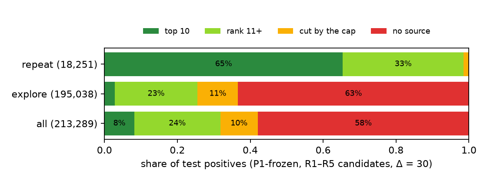

# III. Data and infrastructure

The eleven operational tables (point-of-sale and e-commerce lines, catalogue, prices, stock, loyalty members, favourite
sports, stores, calendar, web and app events) go through Bronze → Silver → Gold in DuckDB / dbt with seven quality gates (QC-1 … 7), answering RQ1.
The unit of prediction is a (member, anchor Monday) pair; a purchase is any non-returned model bought in (t, t + Δ]. Splits are by
anchor date with a 42-day purge gap: train ≤ 2025-09-15, valid 2025-10-27 … 2025-12-22, test 2026-02-02 … 2026-07-27. Main scope is TH + VN (D1): SG labels are reported but
flagged REVIEW. Anchors are capped per country by hash rank (50 000 train, 15 000 valid, 50 000 test).

Every model-generated table carries `fit_cutoff`, `source_ts_max` and `model_version` (D8) and is checked by QC-6: no row may read an
event at or after its anchor, and no fit may use a cutoff later than the anchor. Learned candidate sources and signal models are
refitted at 13 quarterly cutoffs (2023-07-01 … 2026-07-01) in every split; an anchor uses the latest cutoff ≤ t (`fig_pit_timeline`). Refitting only once
at the end of train would leave 27 – 34 % of the test positives outside a 5 000-model universe that was 5 – 10 months old; quarterly
refits halve that to 15.5 % (DECISIONS, D8 revised). Rankers are trained once on train and selected on valid.

Hardware: one GH200 node (72 Arm cores, one H100-class GPU, shared). Deep models use bfloat16 mixed precision. Budget: 10 Optuna TPE trials per
model with hyper-parameters (checked with 30 trials on the rankers), and three seeds for the final ranker fits.

# IV. Unconditional evaluation protocol and error analysis

## A. Protocol (D3)

The evaluated unit is every used anchor with at least one non-returned purchase in (t, t + Δ]. Every purchase is a positive,
including those outside the candidate list, which count as misses. Metrics are HR@10, NDCG@K, MRR@20 and Recall@K over all positives,
plus recall_repeat@20 and recall_explore@20 (a repeat is a model the member bought on or before t; NBR reality check). Confidence intervals
come from a bootstrap over members (500 resamples); model differences use a paired bootstrap over the same members (1 000 resamples).

## B. The reference model under the new protocol (t28)

| P1-frozen, test, Δ = 30 | anchors | NDCG@20 | HR@10 | recall_repeat@20 | recall_explore@20 | candidate recall |
|---|---:|---:|---:|---:|---:|---:|
| conditional (KTXLDL protocol), TH + VN | 25 538 | 0.206 | 0.368 | 0.826 | 0.218 | 1.000 |
| unconditional, TH + VN | 41 734 | **0.095** | 0.225 | 0.824 | 0.073 | 0.370 |
| unconditional, all countries | 63 574 | 0.090 | 0.217 | 0.797 | 0.065 | 0.351 |

The conditional protocol drops the 40.7 % of the anchors whose list holds no purchase; that halves the headline number.

## C. Where the errors are (t28b)

Each of the 213 289 test positives is put in one cell: ranked in the top 10, ranked below 10, proposed by a source but cut by the
200 cap, or proposed by no source.

| P1-frozen, test | positives | top 10 | rank 11 + | capped | no source |
|---|---:|---:|---:|---:|---:|
| repeat | 18 251 | 0.654 | 0.332 | 0.013 | 0.002 |
| explore | 195 038 | 0.028 | 0.227 | 0.111 | 0.634 |
| all | 213 289 | 0.082 | 0.236 | 0.103 | 0.580 |

Repeat is largely solved; explore is 91 % of the positives and 74.5 % of it never reaches the ranker. 95 % of the capped positives come
from R5 (national top 300), whose lower ranks do not fit the cap. The positives without a source are mid-tail, not long-tail: 95 %
have a popularity rank between 301 and 5 000 at the anchor, so a learned source over a per-country universe of the top 5 000 models
can reach them while losing only ~3 % of the positives. R4 (sport × offer, recall 0.0002) is dropped: only 1.07 % of the anchors
have a favourite sport. These facts set the agenda of section V.
