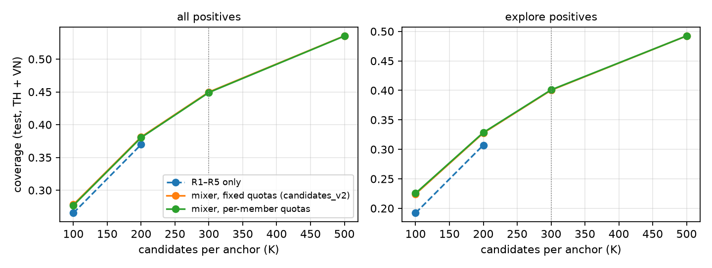

# V. Learned retrieval

## A. Sources

R1 (repurchase) already holds 99.7 % of the repeat positives, so every learned source is **explore-only**: it masks the models the
member bought before the anchor and is tuned on the explore coverage it *adds* to R1–R5@200 on valid (Δ cand_explore of the union),
not on its own recall. Each source is fitted per country at each quarterly cutoff over the top 5 000 models by buyers in the
previous 365 days, and proposes 100 candidates per anchor.

| Source | Model | Tuned (10 trials) | Best valid Δ cand_explore |
|---|---|---|---:|
| R6 | EASE, closed-form item–item | λ | +0.085 |
| R7 | item2vec (skip-gram over purchase sequences) | defaults | +0.074 |
| R8 | TIFU-KNN, time-decayed personal frequency + neighbours | k, r_b, r_g, α | +0.057 |
| R9 | two-tower, full-universe masked softmax over explore targets | d, τ, lr, dropout | +0.074 |
| R10 | SASRec, one step per basket, dense all-action explore loss | d, blocks, dropout, lr | +0.085 |
| R11 | explin: windowed linear model X = history < t → Y = explore in (t, t + Δ] | λ, half-life | +0.074 |
| R12 | RP3beta, popularity-reweighted random walk | α, β | +0.088 |
| R13 | context-aware trend (recent popularity × member's departments and price band) | window, department and price weights | +0.069 |

Exact search on the GPU replaces an ANN index: with 5 000 models per country a full matrix product is cheaper.

## B. Mixer and the cap

The ranker gets at most K candidates. The mixer interleaves the sources by weighted rank quotas: a candidate's key is
min over sources s of (rank_s − 0.5) / w_s, where w_s is the source's stand-alone valid Recall@100; the K smallest keys are kept. A
per-member variant scales w_R1 by the member's repeat share; it ties with the fixed policy on valid (TH + VN cand@300 0.4841 vs
0.4847), so the fixed policy is used. K = 300 is chosen from the recall–cost curve (t30_curve): it meets the coverage target at 1.5×
the pairs of the KTXLDL build, while K = 500 adds +0.085 for about 1.6× the pairs of K = 300.

## C. Coverage (t30a, t30)

| test, TH + VN, Δ = 30 | list | cand | cand_repeat | cand_explore |
|---|---:|---:|---:|---:|
| R1–R5 (KTXLDL) | 200 | 0.370 | 0.997 | 0.307 |
| R1–R5 ∪ R12 RP3beta (best single addition) | 277 | 0.439 | 0.997 | 0.386 |
| R1–R5 ∪ R6 EASE / R10 SASRec / R7 item2vec | 260 – 282 | 0.430 – 0.435 | 0.997 | 0.375 – 0.381 |
| R1–R5 ∪ every learned source (uncapped) | 483 | 0.541 | 0.997 | 0.499 |
| **candidates_v2: mixer, K = 300** | 300 | **0.450** | 0.972 | **0.400** |
| mixer, K = 500 | 470 | 0.535 | 0.994 | 0.492 |

The fixed and per-member mixers overlap at every K. Coverage rises from 0.370 to 0.450 at K = 300, meeting the plan's target (≥ 0.45); explore coverage rises × 1.30, short of the × 2
target. The cap costs 2.5 points of repeat coverage: R1 lists beyond rank ~60 lose their slots to explore candidates. The sources are
complementary — the union of all eight adds 0.17 over R1–R5 while the best single source adds 0.07 — and the neural sources do not
beat the cheap ones: SASRec ties with EASE, two-tower is below, and RP3beta, the best single source, trains in minutes against about
six GPU-hours of tuning and building for each neural source (t37, section VIII).

QC-6 on candidates_v2: 0 rows with source_ts_max ≥ anchor or fit_cutoff > anchor; at most 300 rows per anchor. The pairs of
candidates_v2 are rendered from the same dbt SQL as Gold (`gld_fs_pair`, `gld_ranking_dataset`) and match it on a parity day up to
float noise.

## D. From recall to NDCG (RQ1, second half)

With the ranker frozen — P1-frozen's hyper-parameters and original feature set, refitted on the v2 pairs — the retrieval gain reaches
NDCG@20 only partly. Paired member bootstrap, test, TH + VN:

| P1-frozen v2 − P1-frozen v1 | Δ | 95 % CI |
|---|---:|---|
| NDCG@20 | +0.0025 | [+0.0018, +0.0032] |
| HR@10 | +0.0052 | |
| recall_explore@20 | +0.0101 | |
| recall_repeat@20 | −0.0315 | |

The gain is significant but small (0.0947 → 0.0973): the frozen ranker has no feature that tells it which learned source proposed a
candidate, it trades repeat recall for explore recall, and most new explore candidates land below rank 20. Section VI asks whether
rankers that see the source ranks convert more of it.

## E. Is the cap binding? K = 500 (t31_v3)

The same mixer cut at K = 500 (candidates_v3, 1.6× the pairs; QC-6, leakage and no-row-loss checks pass) lifts coverage from 0.450
to 0.535 on test. Every ranker was refitted on it with the protocol of section VI (P1-frozen as is; P1-tuned and P3 re-tuned with 10
trials on valid). The decision was taken on valid, where nothing gains: TH + VN NDCG@20 P1-tuned 0.1088 → 0.1079, P3 two heads
0.1087 → 0.1092, P3 one head 0.1096 → 0.1097. K = 300 is kept. Test, reported once afterwards, paired v3 − v2:

| test, TH + VN, NDCG@20 | v2 (K = 300) | v3 (K = 500) | paired Δ | 95 % CI |
|---|---:|---:|---:|---|
| P1-frozen | 0.0973 | 0.0963 | −0.0009 | [−0.0016, −0.0003] |
| P1-tuned | 0.1011 | 0.1008 | −0.0003 | [−0.0008, +0.0001] |
| P3 two heads | 0.1009 | 0.1015 | +0.0006 | [−0.0000, +0.0011] |
| P3 one head | 0.1020 | 0.1032 | +0.0012 | [+0.0007, +0.0017] |

Eight more points of coverage buy at most one thousandth of NDCG@20. The extra candidates are positives the sources rank low, and
the GBDT loses repeat recall (−0.025) to the extra negatives; P3, which scores the whole list jointly, holds repeat recall and gains a
little explore recall. The one-head gain on test is significant but absent on valid, so it is reported as a sensitivity result, not
used to change the selection. The cap is not what limits accuracy: ranking the hard explore candidates is.
