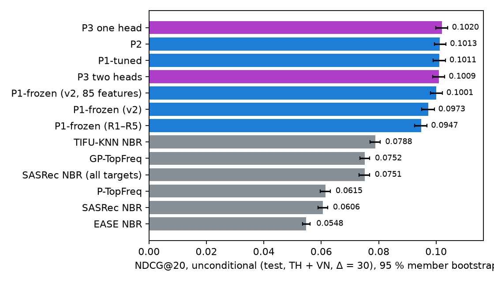
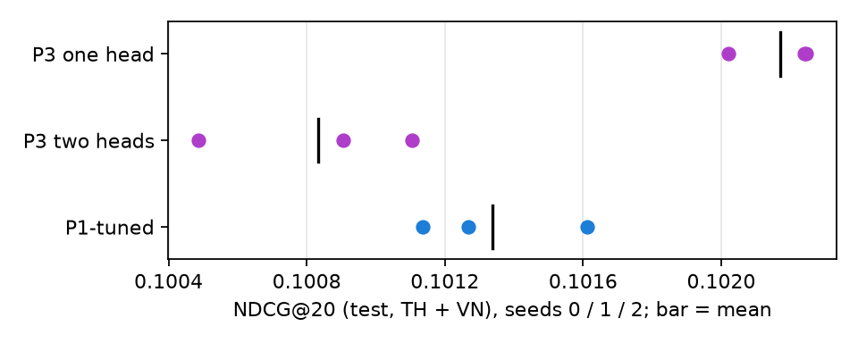
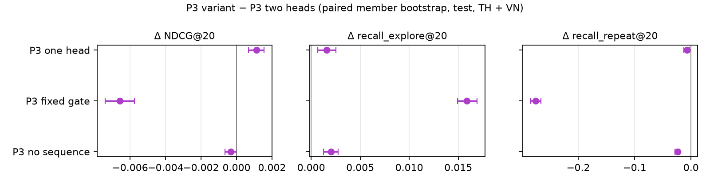

# VI. Ranking

All rankers score the same candidates_v2 lists (K = 300) and are selected on unconditional valid NDCG@20 with 10 TPE trials (D5).

- **P1-frozen** — the baseline LambdaRank with its frozen hyper-parameters and 73 Gold pair features, refitted on the v2 pairs. A
  reference row, not a tuned competitor.
- **P1-tuned** — LightGBM LambdaRank over every pair column (85 features: 73 baseline + 12 v2 columns including source ranks of R6 – R13).
- **P2** — P1-tuned plus five stacked signals fitted with the rolling protocol (D7): a LightGBM department hazard (member ×
  department rows, P(buy in (t, t + Δ])) and LightGBM quantile models of willingness to pay (log unit price, α = 0.5 on median log-price and α = 0.9 on max log-price, plus candidate price gaps).
- **P3 (UMTR)** — a bidirectional Transformer over the last 50 purchase lines (model, log-gap and reverse-position embeddings), a context MLP (`self.ctx(x[:, 0])`), an item
  tower over the candidate's embeddings and 100 dense pair features (84 signed-log standardised columns + 16 NaN flags), and scaled dot-product DIN-style target attention of each candidate over the sequence. Two heads, repeat and explore,
  each with a softmax inside its group; a learned gate g(u) gives the repeat group mass g and the explore group 1 − g, trained with
  BCE on the repeat share of the member's unconditional positives. Auxiliary Δ = 90 head; listwise loss; 6 epochs restoring the best checkpoint on unconditional valid NDCG@20. 3.73 M parameters.
- **Baselines (D10)** — five full-catalogue NBR families (six rows): P-TopFreq, GP-TopFreq, EASE and TIFU-KNN with their own 10-trial budget,
  and SASRec reusing the R10 network and parameters in two forms (explore-trained unmasked, and SASRecAll retrained on all targets).

# VII. Results

## A. RQ2: who wins (t31)

Test, TH + VN, 41 734 anchors, Δ = 30, unconditional; 95 % member-bootstrap intervals.

| Model | NDCG@20 | 95 % CI | HR@10 | recall_repeat@20 | recall_explore@20 | cand recall |
|---|---:|---|---:|---:|---:|---:|
| P-TopFreq | 0.0615 | [0.0597, 0.0632] | 0.156 | 0.877 | 0.000 | 0.093 |
| GP-TopFreq | 0.0752 | [0.0734, 0.0769] | 0.184 | 0.878 | 0.041 | 0.262 |
| EASE NBR | 0.0548 | [0.0535, 0.0561] | 0.146 | 0.368 | 0.072 | 0.231 |
| TIFU-KNN NBR | 0.0788 | [0.0770, 0.0806] | 0.187 | 0.885 | 0.043 | 0.234 |
| SASRec NBR | 0.0606 | [0.0589, 0.0622] | 0.156 | 0.435 | 0.067 | 0.235 |
| P1-frozen (v1 candidates) | 0.0947 | [0.0925, 0.0968] | 0.225 | 0.824 | 0.073 | 0.370 |
| P1-frozen (v2) | 0.0973 | [0.0949, 0.0994] | 0.230 | 0.793 | 0.083 | 0.450 |
| P1-tuned (v2) | 0.1011 | [0.0990, 0.1033] | 0.239 | 0.817 | 0.092 | 0.450 |
| P2 (v2) | 0.1013 | [0.0994, 0.1034] | 0.240 | 0.806 | 0.093 | 0.450 |
| P3 two heads | 0.1009 | [0.0988, 0.1029] | 0.237 | 0.845 | 0.089 | 0.450 |
| **P3 one head** | **0.1020** | [0.0999, 0.1040] | 0.240 | 0.838 | 0.090 | 0.450 |

Paired member bootstrap (t31_paired), NDCG@20 difference [95 % CI]:

| a − b | NDCG@20 | recall_explore@20 |
|---|---|---|
| P1-tuned − P1-frozen (v2) | +0.0039 [+0.0032, +0.0045] | +0.0085 |
| P2 − P1-tuned | +0.0002 [−0.0002, +0.0006] | +0.0007 (n.s.) |
| P3 two heads − P1-tuned | −0.0002 [−0.0009, +0.0005] | −0.0031 |
| P3 one head − P1-tuned | +0.0009 [+0.0002, +0.0016] | −0.0016 |
| P3 one head − P2 | +0.0007 [+0.0000, +0.0014] | −0.0023 |
| P1-tuned − TIFU-KNN NBR | +0.0224 [+0.0214, +0.0234] | +0.0488 |

Read as answers rather than a leaderboard:

- Every two-stage ranker beats every next-basket baseline by a wide margin (P1-tuned − TIFU-KNN: +0.022, +28 %). The strongest
  baseline is TIFU-KNN, then GP-TopFreq; the learned-embedding baselines (EASE, SASRec) are below popularity because without the cap of
  a ranker they give up the repeats (recall_repeat 0.37 – 0.43 against 0.88).
- Tuning matters more than model family: P1-tuned gains +0.0039 over the frozen parameters on the same pairs, more than the whole RQ1
  retrieval gain under the frozen ranker (+0.0025).
- The deep model and the GBDT are within a thousandth. P3 with one head is the only model significantly above P1-tuned (+0.0009,
  about 1 %), and only just above P2. The two-head P3 ties with P1-tuned: it keeps more repeats (+0.029 recall_repeat) and finds fewer
  explore purchases (−0.003).
- Stacking adds nothing measurable (P2 − P1-tuned +0.0002, interval across 0), consistent with t29b: the Gold pair features already
  hold department recency, cycles and price gaps.

Selected on valid (P3 one head 0.1049, P3 two heads 0.1037, P2 0.1034, P1-tuned 0.1033), the order is the same as on test.

*Seed variance (t31_seeds).* The final fits of P1-tuned, P3 two heads and P3 one head were repeated with seeds 1 and 2 (same
hyper-parameters; LightGBM bagging / feature sampling and the network initialisation and batch order change). Test, TH + VN:

| Model | NDCG@20, seeds 0 / 1 / 2 | mean ± sd | recall_repeat@20 mean ± sd |
|---|---|---|---|
| P1-tuned | 0.1011 / 0.1013 / 0.1016 | 0.1013 ± 0.0002 | 0.809 ± 0.007 |
| P3 two heads | 0.1009 / 0.1005 / 0.1011 | 0.1008 ± 0.0003 | 0.824 ± 0.030 |
| P3 one head | 0.1020 / 0.1022 / 0.1022 | 0.1022 ± 0.0001 | 0.831 ± 0.008 |

The seed spread (≤ 0.0003) is below the gap between P3 one head and P1-tuned, and the seed-matched paired differences are
+0.0009, +0.0010 and +0.0006 (the last with a lower bound of −0.0000; t31_seeds_paired). One head beats two heads at every seed
(+0.0011, +0.0018, +0.0011). The two-head model is the least stable: its repeat recall moves from 0.79 to 0.85 across seeds, i.e.
the learned gate lands in different places from one run to the next.

*Tuning budget (t31_b30).* The best of the 10-trial studies sat at the learning-rate floor (GBDT 0.029 against 0.02, P3 0.0001 = the
floor) and was the last GBDT trial, so P1-tuned, P2 and P3 were re-tuned with the plan's 30 trials each and the floor lowered (GBDT
0.005, P3 0.00002); about 3.2 wall-hours on 32 threads for each GBDT study and 0.75 GPU-hour for P3. Valid, TH + VN NDCG@20, 10 → 30 trials:
P1-tuned 0.1088 → 0.1089, P2 0.1089 → 0.1088, P3 two heads 0.1087 → 0.1086, P3 one head 0.1096 → 0.1092 — the 10-trial fits are
kept. Test, reported once (paired 30 − 10 trials): P1-tuned +0.0001 [−0.0003, 0.0006], P2 +0.0007 [0.0003, 0.0011], P3 two heads
−0.0002 [−0.0005, 0.0001], P3 one head −0.0000 [−0.0003, 0.0003]. The search had converged: three times the budget moves no model
by more than the seed spread, except a small P2 gain on test that valid does not show.

*Purchase history only (t31_hist).* The business recommends today from purchase history alone. To separate what the extra data
dimensions bring from what the pipeline brings, P1 was re-tuned (10 trials) and refitted on the same v2 pairs with only the 39
features a purchase log yields: R1 / R2 / R5 and the learned source ranks, own and department history, co-purchase, sales
popularity / season / model age, activity counts and country. Web behaviour (R3 and the mixed candidate rank), prices and
promotions, stock, stores, calendar, sport affinity and the member price profile are removed. Test, TH + VN:

| Data | Status quo / classical | Pipeline (retrieval + learned ranker) |
|---|---|---|
| Purchase history only | GP-TopFreq 0.0752, P-TopFreq 0.0615, TIFU-KNN 0.0788 | P1-hist 0.0966 |
| Multi-dimensional | — | P1-tuned 0.1011, P3 one head 0.1020 |

Paired (t31_hist_paired): P1-hist − GP-TopFreq +0.0214 [0.0204, 0.0225], P1-tuned − P1-hist +0.0045 [0.0039, 0.0052], P3 one
head − P1-hist +0.0054 [0.0046, 0.0062]; valid gives the same order (0.0819, 0.1044, 0.1088, 0.1096). Of the +0.0268 that P3 one
head gains over the status quo, about four fifths are reached on purchase history alone, by multi-source retrieval and a learned
ranker; the remaining fifth needs the other dimensions and shows up in explore recall (P1-tuned − P1-hist +0.0077), i.e. in
recommending models the member has not bought yet. Two choices make the history-only row slightly optimistic: the candidate pool
is the multi-dimensional one (it still holds the web-intent candidates, without the features that explain them), and the
two-tower and trend sources use the unit price paid on the sales lines.

## B. By country and segment (t34)

NDCG@20 on test (segments by transactions in the 365 days before the anchor: new ≤ 1, mid 2, loyal ≥ 3; all countries):

| Model | SG | TH | VN | new | mid | loyal |
|---|---:|---:|---:|---:|---:|---:|
| TIFU-KNN NBR | 0.069 | 0.085 | 0.072 | 0.065 | 0.080 | 0.078 |
| P1-frozen (v1) | 0.082 | 0.101 | 0.088 | 0.079 | 0.094 | 0.095 |
| P1-tuned (v2) | 0.089 | 0.108 | 0.093 | 0.089 | 0.101 | 0.099 |
| P3 two heads | 0.089 | 0.107 | 0.093 | 0.088 | 0.101 | 0.100 |
| P3 one head | 0.090 | 0.109 | 0.094 | 0.090 | 0.101 | 0.100 |

The ordering holds in every country and segment; differences between P1-tuned and P3 stay below 0.002 everywhere. The largest gain
of the whole pipeline over the reference is on new members (0.079 → 0.090, +14 %), whose purchases are almost all explore and who
benefit most from the learned sources. SG (REVIEW scope) gains as much as TH and VN. The web / no-web split of the plan is not
reported: 2 – 19 % of the anchors have web events (KTXLDL t09) and the web features carry about 1 % of the SHAP mass (t35a).

## C. RQ3: repeat and explore heads (t32)

| P3 variant − P3 two heads (paired) | NDCG@20 | HR@10 | recall_repeat@20 | recall_explore@20 |
|---|---|---|---|---|
| one head | +0.0011 [+0.0007, +0.0016] | +0.0025 | −0.0073 | +0.0016 |
| fixed gate (g = member's repeat share) | −0.0066 [−0.0074, −0.0058] | −0.0105 | −0.2753 | +0.0159 |
| no sequence (member context only) | −0.0003 [−0.0007, +0.0000] | +0.0001 | −0.0240 | +0.0020 |

The explicit split does **not** improve explore: the single head is better on NDCG@20 *and* on explore recall, at a small cost in
repeat recall. The gate is the part that matters — replacing the learned g by the member's historical repeat share loses 0.0066
NDCG@20 and a third of the repeat recall; a plausible reading is that a member's past repeat share (about 10 % of positives)
under-weights the repeat group for the anchors where a repeat is due, which the learned gate can see from the context. The learned gate ranks segments correctly (mean g: loyal 0.23, mid 0.17, new 0.14) but is not
calibrated — it is about twice the observed repeat share (0.12, 0.08, 0.06; t35c) — and correlates only weakly with the per-anchor
target (0.11 – 0.19). The sequence encoder adds repeat recall (+0.024) but no NDCG: the pair features already summarise the history.

## D. H1: stacking leakage (t29, t29b)

The department hazard, fitted three ways (t29, AUC on train / pseudo-test / test): rolling 0.681 / 0.703 / 0.708, naive 0.725 /
0.744 / 0.705, leaky 0.710 / 0.717 / 0.723. The in-sample fit looks 0.04 AUC better on the anchors it has seen and loses that lead on
test; the leaky fit stays better on test because it has seen those labels.

Fused into a ranker (P1-frozen parameters, fitted on train anchors ≤ 2025-05-31; unconditional NDCG@20, TH + VN):

| Signals | v1 train | v1 pseudo-test | v1 test | v2 train | v2 pseudo-test | v2 test |
|---|---:|---:|---:|---:|---:|---:|
| none | 0.1219 | 0.1072 | 0.0941 | 0.1246 | 0.1097 | 0.0961 |
| rolling | 0.1227 | 0.1090 | 0.0945 | 0.1255 | 0.1097 | 0.0964 |
| naive | 0.1246 | 0.1095 | 0.0934 | 0.1281 | 0.1126 | 0.0959 |
| leaky | 0.1232 | 0.1087 | 0.0944 | 0.1256 | 0.1091 | 0.0975 |

H1 holds in direction on both candidate sets, more clearly on v2: the naive fusion is ahead of rolling on its own training anchors
(+0.0026) and on the pseudo-test (+0.0029), and behind it on test (−0.0004; v1: +0.0019 / +0.0005 / −0.0011). The leaky fusion is the
only one ahead on test (+0.0011 on v2), because its signals were fitted on the test labels. The inflation is small because the
signals are weak given the Gold features, and the gaps are of the order of the member-bootstrap intervals (± 0.002 on test,
± 0.005 on the 5 337 pseudo-test anchors). The practical conclusion is the one the plan anticipated: an in-sample stacked signal
would have been reported as a gain that does not exist on test.

## E. What the GBDT uses (t35a)

Grouped TreeSHAP over 3 000 test anchors, share of mean |SHAP|:

| Feature group | P1-tuned all | repeat candidates | explore candidates |
|---|---:|---:|---:|
| model: popularity / season / stock | 0.475 | 0.298 | 0.492 |
| retrieval: learned source ranks | 0.165 | 0.202 | 0.162 |
| retrieval: R1 – R5 flags / scores / rank | 0.085 | 0.140 | 0.079 |
| member: price profile | 0.080 | 0.031 | 0.085 |
| pair: own history | 0.027 | 0.155 | 0.014 |
| web behaviour | 0.013 | 0.013 | 0.013 |

The learned source ranks are the second group (17 %), which is why the tuned rankers convert more of the retrieval gain than the
frozen one, which does not see them. In P2 the five stacked signals take 2.4 % of the mass.
